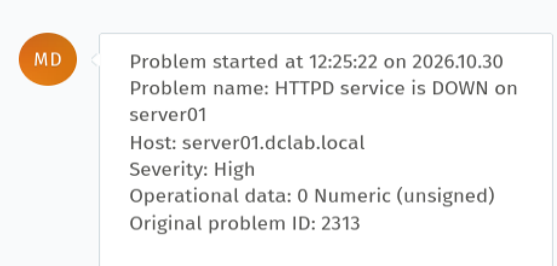
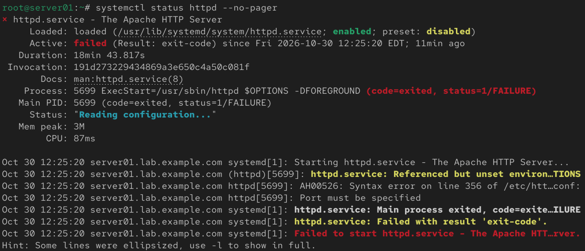
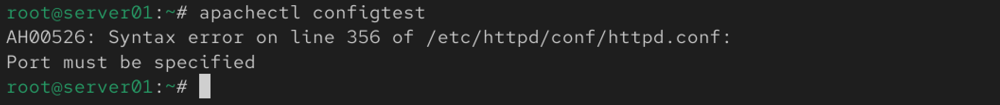
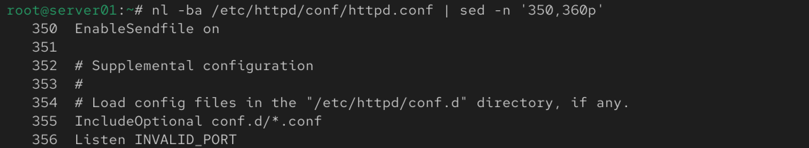

# Incident 001 — Apache HTTPD Configuration Error

## Overview

A monitoring alert reported that the Apache HTTP service (`httpd`) was unavailable on `server01`.

The incident was detected automatically by Zabbix and generated a High-severity alert.

## Environment

* **Operating System:** CentOS Stream
* **Server:** server01
* **Service:** Apache HTTP Server (`httpd`)
* **Monitoring:** Zabbix
* **Ticketing:** Zammad
* **Web Server:** Apache 2.4

## Detection

Zabbix detected that the HTTPD process was no longer running.

**Alert:**

* Problem: `HTTPD service is DOWN on server01`
* Severity: High
* Operational data: `0`

The monitoring system generated an incident notification automatically.

### Evidence — Monitoring Alert



## Investigation

The HTTPD service status was checked:

```bash
systemctl status httpd --no-pager
```

The service was in a failed state:

```text
Active: failed (Result: exit-code)
status=1/FAILURE
```

### Evidence — Service Failure



Apache configuration validation was then performed:

```bash
apachectl configtest
```

The validation returned:

```text
AH00526: Syntax error on line 356 of /etc/httpd/conf/httpd.conf:
Port must be specified
```

### Evidence — Apache Configuration Error



The affected section of the configuration file was inspected:

```bash
nl -ba /etc/httpd/conf/httpd.conf | sed -n '350,360p'
```

Line 356 contained:

```text
Listen INVALID_PORT
```

## Root Cause

Apache could not start because `/etc/httpd/conf/httpd.conf` contained an invalid `Listen` directive:

```text
Listen INVALID_PORT
```

Apache requires a valid TCP port number for the `Listen` directive.

## Resolution

The Apache configuration file was edited:

```bash
vi /etc/httpd/conf/httpd.conf
```

The invalid directive was changed from:

```text
Listen INVALID_PORT
```

to:

```text
Listen 80
```

### Evidence — Root Cause



Before restarting the service, the configuration was validated:

```bash
apachectl configtest
```

Result:

```text
Syntax OK
```

Apache was then restarted:

```bash
systemctl restart httpd
```

## Verification

The service status was verified:

```bash
systemctl status httpd --no-pager
```

Result:

```text
Active: active (running)
```

HTTP functionality was independently verified:

```bash
curl -I http://localhost
```

Result:

```text
HTTP/1.1 200 OK
```

## Monitoring Verification

After service restoration, the monitoring system automatically detected the recovery.

Zabbix/Zammad reported:

```text
Problem has been resolved
```

The original High-severity HTTPD incident was successfully closed.

## Incident Workflow

```text
Zabbix Alert
     ↓
HTTPD service failure confirmed
     ↓
Apache configuration tested
     ↓
Syntax error identified
     ↓
Invalid Listen directive located
     ↓
Configuration corrected
     ↓
Syntax validated
     ↓
HTTPD restarted
     ↓
HTTP 200 OK verified
     ↓
Monitoring recovery confirmed
```

## Skills Demonstrated

* Linux service troubleshooting with systemd
* Apache HTTP Server administration
* Configuration validation with `apachectl`
* Linux log and service-status analysis
* HTTP service verification with `curl`
* Zabbix monitoring
* Incident-response methodology
* Root cause analysis
* Post-repair monitoring verification
