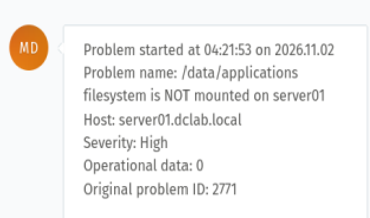
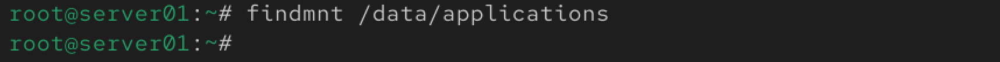
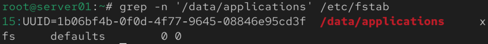
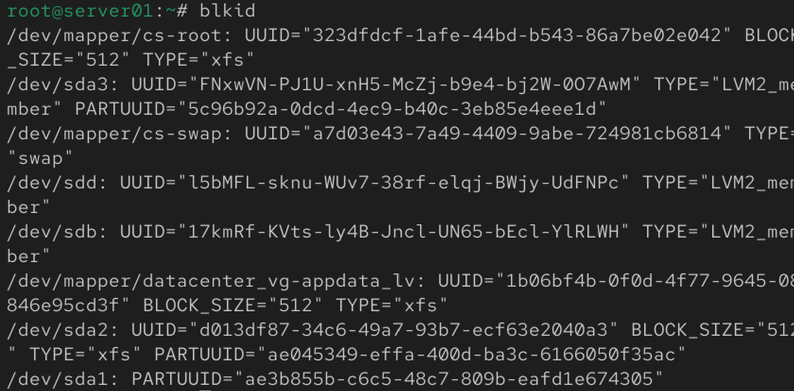
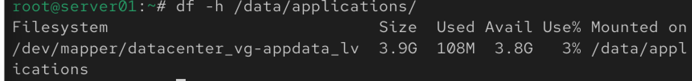
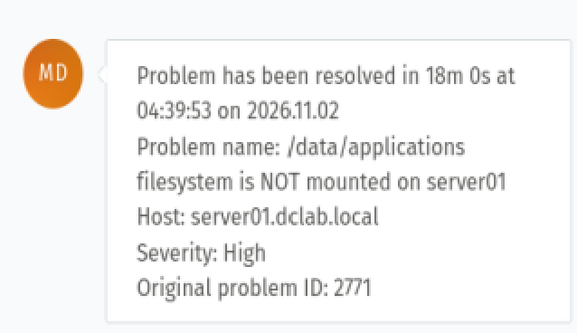

# Incident 002 — Filesystem Not Mounted

## Overview

Zabbix detected that the `/data/applications` filesystem was no longer mounted on `server01`.

The monitoring system generated a High-severity incident, allowing the storage issue to be investigated and restored.

## Environment

- **Operating System:** CentOS Stream
- **Server:** server01
- **Storage:** LVM
- **Filesystem:** XFS
- **Mount Point:** `/data/applications`
- **Monitoring:** Zabbix
- **Ticketing:** Zammad

## Detection

Zabbix generated the following alert:

- **Problem:** `/data/applications filesystem is NOT mounted on server01`
- **Severity:** High
- **Operational data:** `0`
- **Problem ID:** `2771`



## Investigation

The mount status was checked:

```bash
findmnt /data/applications
```

No filesystem was returned, confirming that `/data/applications` was not mounted.



The persistent mount configuration was then inspected:

```bash
grep -n '/data/applications' /etc/fstab
```

The system contained the following configuration:

```text
UUID=1b06bf4b-0f0d-4f77-9645-08846e95cd3f /data/applications xfs defaults 0 0
```



The filesystem UUID was verified:

```bash
blkid
```

The expected UUID was found on:

```text
/dev/mapper/datacenter_vg-appdata_lv
```

with:

```text
UUID="1b06bf4b-0f0d-4f77-9645-08846e95cd3f"
TYPE="xfs"
```



This confirmed that the logical volume and XFS filesystem were available and that the `/etc/fstab` entry referenced the correct filesystem.

## Root Cause

The `/data/applications` filesystem had become unmounted.

The underlying LVM logical volume was still available, the XFS filesystem was intact, and the UUID configured in `/etc/fstab` was correct.

The issue was therefore isolated to the filesystem not being mounted rather than a missing logical volume, incorrect UUID, or damaged persistent mount configuration.

## Resolution

The persistent mount configuration was applied:

```bash
mount -a
```

The mount was then verified:

```bash
findmnt /data/applications
```

The filesystem was successfully restored:

```text
TARGET              SOURCE                                  FSTYPE
/data/applications  /dev/mapper/datacenter_vg-appdata_lv   xfs
```


## Verification

Filesystem capacity and mount status were verified:

```bash
df -h /data/applications
```

Result:

```text
Filesystem                               Size  Used  Avail  Use%  Mounted on
/dev/mapper/datacenter_vg-appdata_lv     3.9G  108M   3.8G    3%  /data/applications
```



The filesystem was mounted correctly and had approximately 3.8 GB of available space.

## Monitoring Verification

After the filesystem was restored, the monitoring system automatically detected recovery.

Zabbix/Zammad reported:

```text
Problem has been resolved in 18m 0s
Problem name: /data/applications filesystem is NOT mounted on server01
Severity: High
Original problem ID: 2771
```



## Skills Demonstrated

- Linux filesystem troubleshooting
- LVM storage verification
- XFS filesystem administration
- `/etc/fstab` configuration analysis
- UUID verification with `blkid`
- Mount troubleshooting with `findmnt`
- Persistent filesystem recovery with `mount -a`
- Disk utilization verification with `df`
- Zabbix monitoring
- Zammad incident notification
- Incident investigation and documentation

## Incident Status

**RESOLVED**
