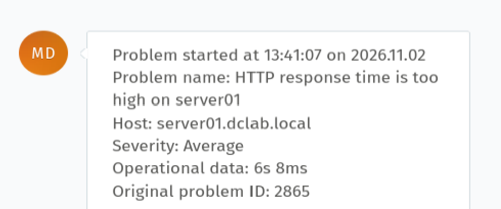
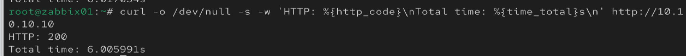
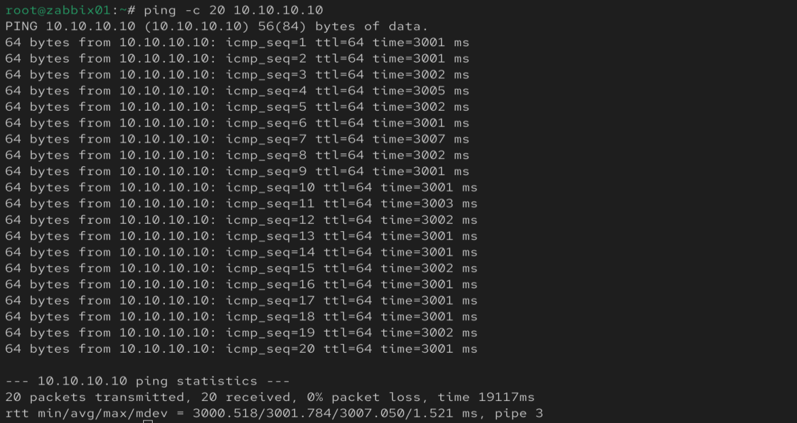
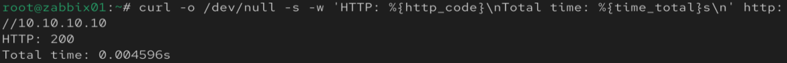
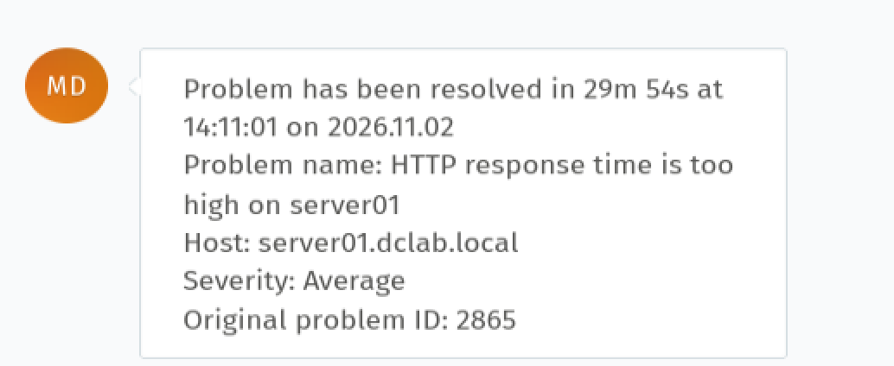

# Incident 003 — HTTP Response Time Too High

## Issue

Zabbix detected abnormally high HTTP response time on `server01`.

- Host: `server01.dclab.local`
- Severity: Average
- Zabbix Problem ID: 2865
- Zammad Ticket ID: 101

## Detection

Zabbix Web Monitoring generated the following alert:



`HTTP response time is too high on server01`

The configured trigger detected an HTTP response time greater than 2 seconds.

Zammad automatically generated a ticket for the incident.

## Investigation

HTTP connectivity was first tested from the Zabbix server:

```bash
curl -o /dev/null -s -w 'HTTP: %{http_code}\nTotal time: %{time_total}s\n' http://10.10.10.10
```
Result:
HTTP: 200
Total time: ~6 seconds


The application was available, but response time was abnormally high.

Network latency was then tested:
ping -c 20 10.10.10.10

Result:
0% packet loss
Average latency: ~3001 ms


Traffic control configuration on server01 was inspected:
tc qdisc show dev enp0s8

Result showed:
qdisc netem ... delay 3s


## Root Cause
A Linux Traffic Control netem rule was configured on network interface enp0s8, introducing approximately 3 seconds of artificial network latency.
Resolution
The traffic control rule was removed:
tc qdisc del dev enp0s8 root

## Verification
Traffic control was checked again:
tc qdisc show dev enp0s8

The netem delay 3s rule was no longer present.

Network latency returned to normal:


Average ping: ~1.1 ms
0% packet loss

HTTP performance was tested again:
HTTP: 200
Total time: 0.004596s

## Monitoring Verification
Zabbix automatically changed the incident status:


PROBLEM → RESOLVED

Recovery occurred after 29m 54s.

Zammad also received the automatic recovery notification.
## Skills Demonstrated
- Linux network troubleshooting
- HTTP performance troubleshooting
- Zabbix Web Monitoring
- Zammad incident management
- Linux Traffic Control (tc)
- Network emulation (netem)
- Root cause analysis
- Post-resolution verification


Document Incident 003 HTTP latency troubleshooting
