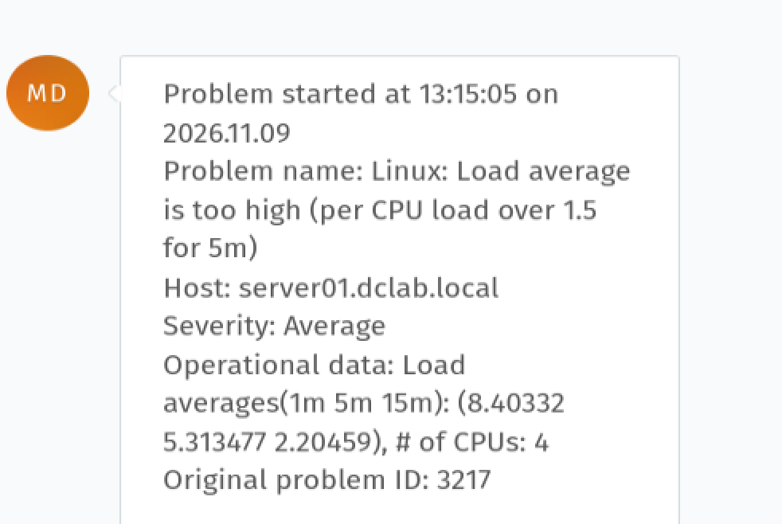
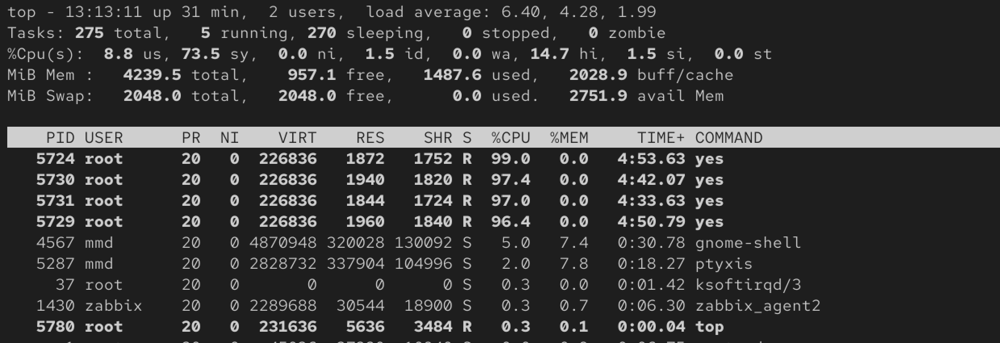
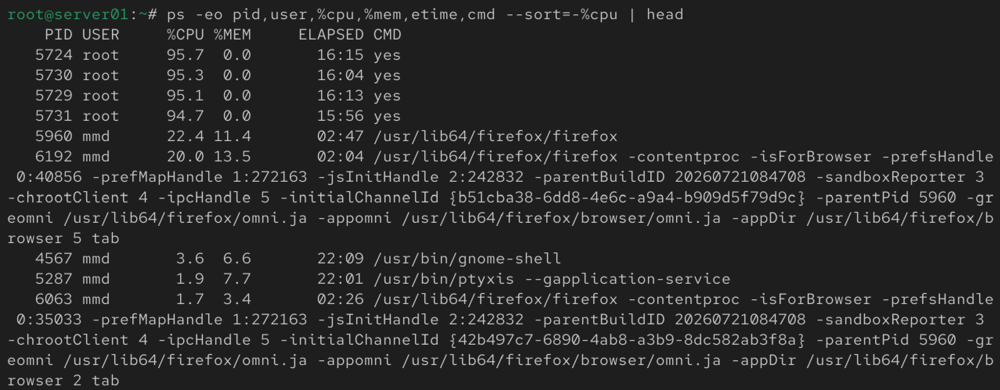
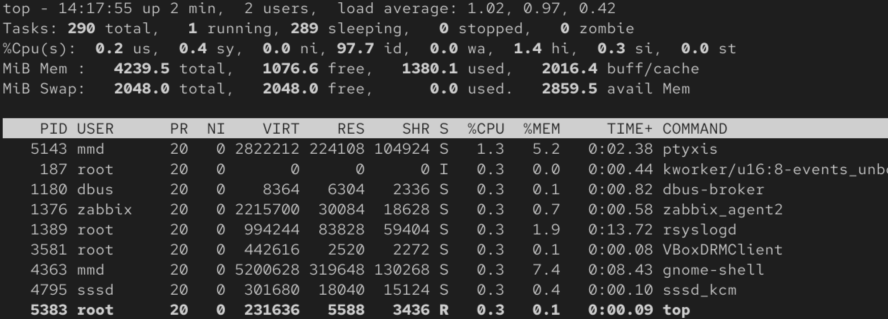
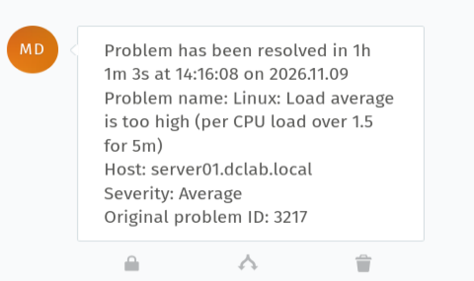

# Incident 005 — High CPU Load on server01

## Issue

Zabbix detected an abnormally high system load on `server01`.

- Host: `server01.dclab.local`
- Severity: Average
- Zabbix Problem ID: 3217
- Alert: `Linux: Load average is too high`

## Detection

Zabbix generated the following alert:

`Linux: Load average is too high`

The configured monitoring threshold detected a per-CPU load greater than `1.5` for 5 minutes.

At the time of detection, Zabbix reported elevated load averages:

```text
1 min: 8.40332
5 min: 5.313477
15 min: 2.20459
CPUs: 4
```



## Investigation

System CPU utilization was inspected using:

```bash
top
```

The system showed very high CPU utilization with approximately `1.5%` CPU idle.

Four `yes` processes were consuming approximately 96–99% CPU each.



The CPU-intensive processes were then identified more precisely:

```bash
ps -eo pid,user,%cpu,%mem,etime,cmd --sort=-%cpu | head
```

The investigation identified four `yes` processes running as `root`:

```text
PID    USER    %CPU    COMMAND
5724   root    ~95%    yes
5730   root    ~95%    yes
5729   root    ~95%    yes
5731   root    ~95%    yes
```



## Root Cause

Four CPU-intensive `yes` processes were running simultaneously on the four-CPU server.

These processes consumed nearly all available CPU resources and caused the system load average to increase significantly.

The sustained CPU saturation eventually made the graphical interface unresponsive and remote SSH connectivity became unavailable.

## Resolution

An attempt was made to terminate the CPU-intensive processes, but the server had become too unresponsive for normal local or remote administration.

The system was therefore recovered through a controlled restart from the virtualization environment.

The temporary `yes` processes were not persistent and did not return after the restart.

## Verification

After the server restarted, CPU utilization was checked again using:

```bash
top
```

The system returned to normal operation.

CPU idle time increased to approximately:

```text
97.7% idle
```

The previous `yes` processes were no longer running.



## Monitoring Verification

Zabbix automatically detected the recovery and changed the incident status from:

`PROBLEM → RESOLVED`

The monitoring recovery notification confirmed resolution of Zabbix Problem ID `3217`.



## Skills Demonstrated

- Linux CPU performance troubleshooting
- System load analysis
- Process investigation with `top` and `ps`
- PID and CPU utilization analysis
- Linux process troubleshooting
- Zabbix monitoring and alert analysis
- Troubleshooting an unresponsive Linux server
- Virtual machine recovery
- Root cause analysis
- Post-recovery verification
