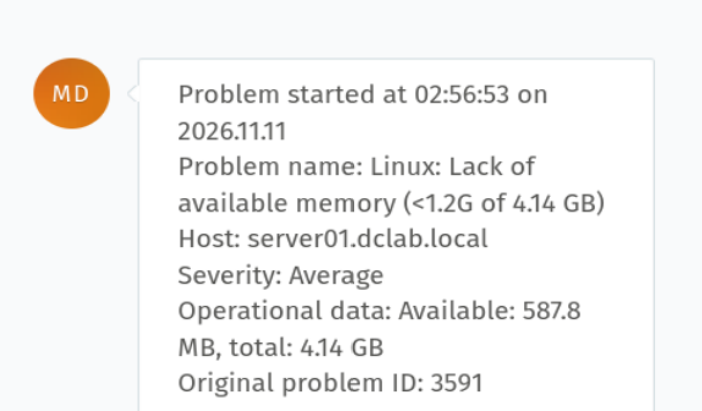
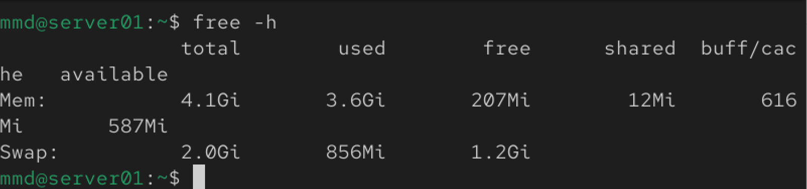
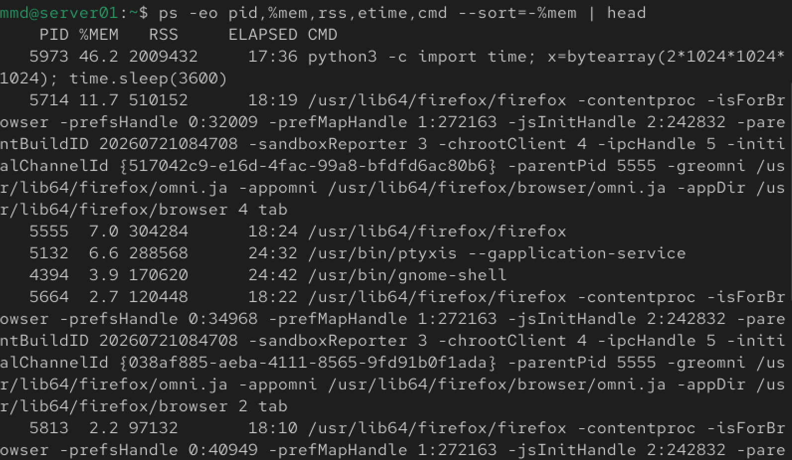
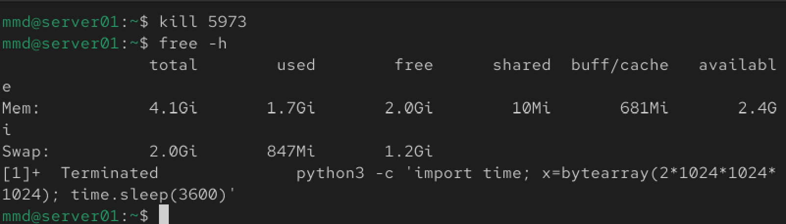
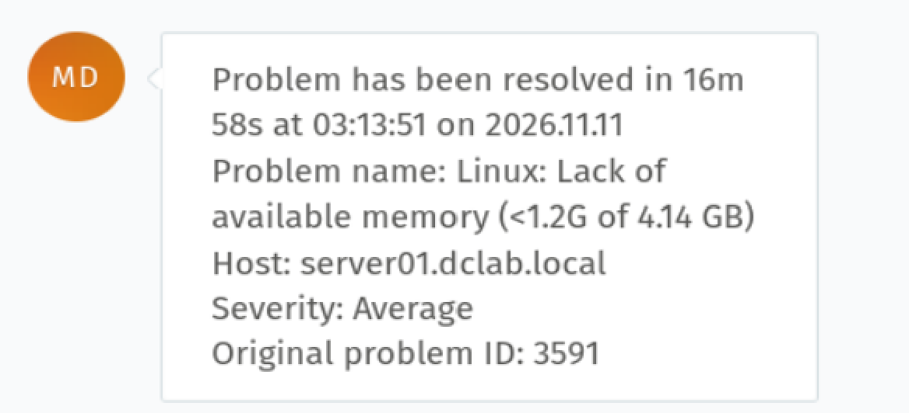

# Incident 006 — Memory Pressure on server01

## Issue

Zabbix detected critically low available memory on `server01`.

- Host: `server01.dclab.local`
- Severity: Average
- Zabbix Problem ID: 3591
- Alert: `Linux: Lack of available memory (<1.2G of 4.14 GB)`

## Detection

Zabbix detected that available memory had fallen below the configured threshold.

At the time of detection, Zabbix reported:

```text
Available memory: 587.8 MB
Total memory: 4.14 GB
```



## Investigation

Memory utilization was checked directly on `server01`:

```bash
free -h
```

The system showed:

```text
Total memory:     4.1 GiB
Used memory:      3.6 GiB
Available memory: 587 MiB
Swap used:        856 MiB
```

This confirmed significant memory pressure and active swap usage.



The processes consuming the most memory were then identified:

```bash
ps -eo pid,user,%mem,rss,etime,cmd --sort=-%mem | head
```

The investigation identified a `python3` process:

```text
PID: 5973
Memory: 46.2%
RSS: 2009432 KiB
```

The process was consuming approximately 2 GiB of physical memory.



## Root Cause

A Python process was intentionally allocating approximately 2 GiB of RAM as part of the lab simulation.

This caused available memory to fall from approximately 2.8 GiB to 587 MiB and forced the operating system to use swap space.

The resulting memory pressure triggered the Zabbix low-memory alert.

## Resolution

The memory-consuming process was terminated gracefully using its PID:

```bash
kill 5973
```

A standard `SIGTERM` was used instead of immediately forcing termination with `SIGKILL`.

## Verification

Memory utilization was checked again:

```bash
free -h
```

Available memory recovered to approximately:

```text
2.4 GiB
```

The terminal also confirmed that the Python process had terminated.



Some swap remained allocated after the process termination. This was expected because Linux does not necessarily move swapped pages back into physical memory immediately when memory pressure disappears.

## Monitoring Verification

Zabbix automatically detected the recovery and changed the incident status from:

`PROBLEM → RESOLVED`

The incident was resolved after approximately `16m 58s`.

Zabbix Problem ID `3591` was successfully cleared.



## Skills Demonstrated

- Linux memory troubleshooting
- RAM and swap analysis
- `free` command analysis
- Process investigation with `ps`
- RSS and memory utilization analysis
- Linux process management
- Graceful process termination with `SIGTERM`
- Zabbix memory monitoring
- Root cause analysis
- Post-resolution verification
