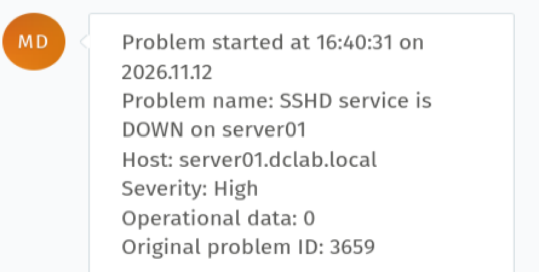
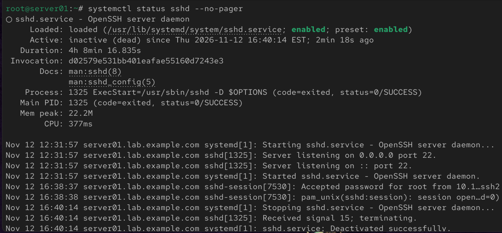
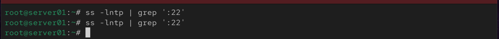
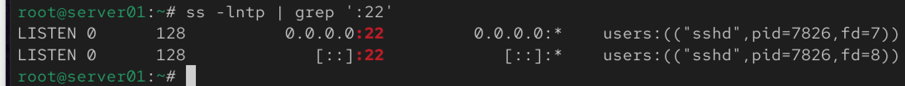
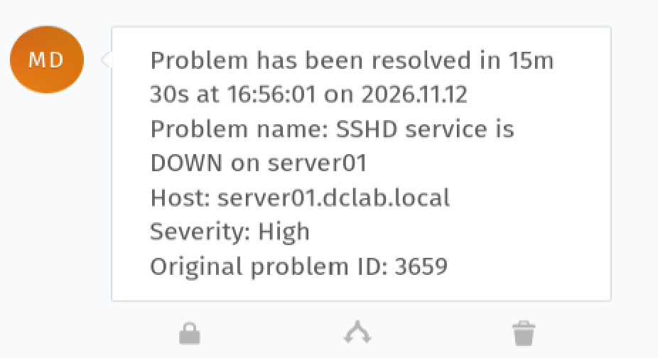

# Incident 008 — SSHD Service Down

## Issue

Zabbix detected that the SSH service on `server01` was unavailable.

- Host: `server01.dclab.local`
- Severity: High
- Zabbix Problem ID: 3659
- Incident duration: 15m 30s

## Detection

Monitoring generated the following alert:

`SSHD service is DOWN on server01`



The monitoring system reported an operational value of `0`, indicating that the SSH service was unavailable.

## Investigation

The SSH service status was checked:

```bash
systemctl status sshd --no-pager
```
The service was:
inactive (dead)

The logs showed that SSHD received signal 15 and terminated successfully.

Port 22 was then checked:
ss -lntp | grep ':22'

No output was returned, confirming that no process was listening on TCP port 22.

The SSH configuration was validated before restarting the service:
sshd -t

No errors were returned, confirming that the SSH configuration was valid.

## Root Cause
The sshd service had been stopped and was no longer listening on TCP port 22.

The service terminated cleanly, and no SSH configuration error was detected.
## Resolution
The SSH service was started:
systemctl start sshd

## Verification
The service status was verified:
systemctl is-active sshd

Result:
active

Port 22 was checked again:
ss -lntp | grep ':22'


SSHD was listening successfully on both IPv4 and IPv6:
0.0.0.0:22
[::]:22

## Monitoring Verification
Zabbix/Zammad automatically reported the incident as resolved.

Recovery occurred at:

16:56:01 on 2026-11-12

Total incident duration:

15m 30s
## Skills Demonstrated
- Linux service troubleshooting
- OpenSSH administration
- systemd service management
- TCP port verification
- SSH configuration validation
- Linux process and service investigation
- Zabbix monitoring
- Zammad incident management
- Root cause analysis
- Post-resolution verification
