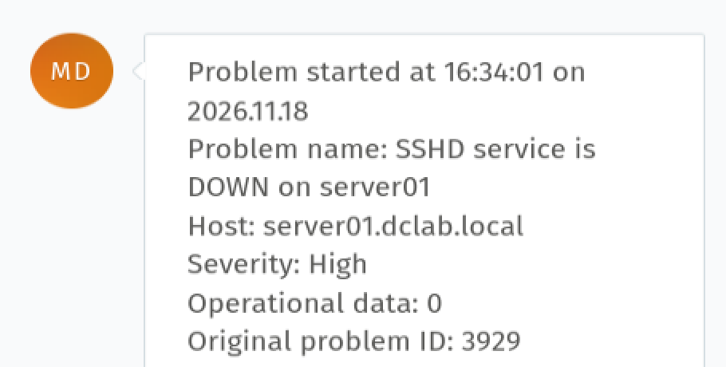
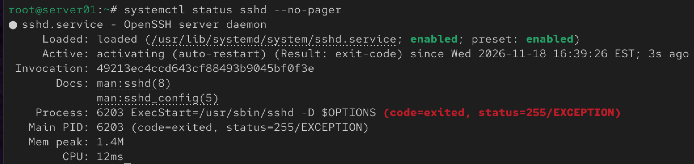
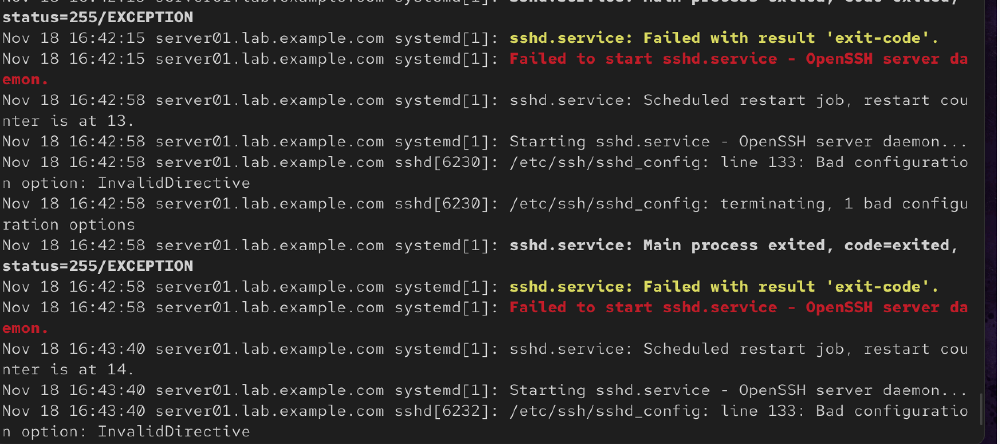
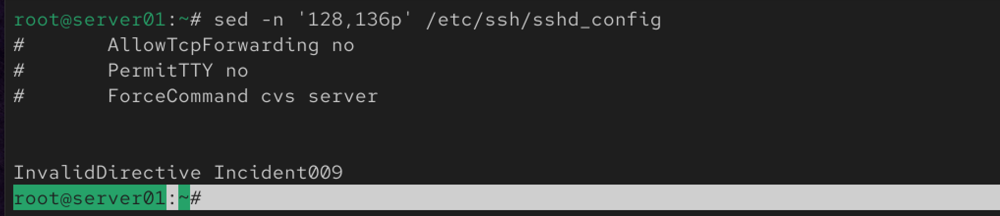
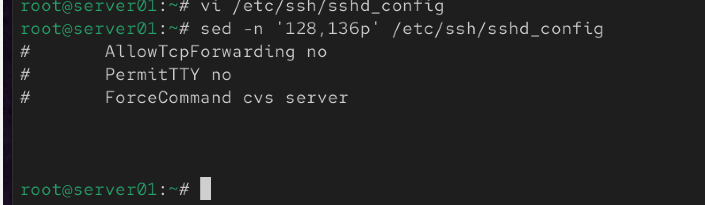
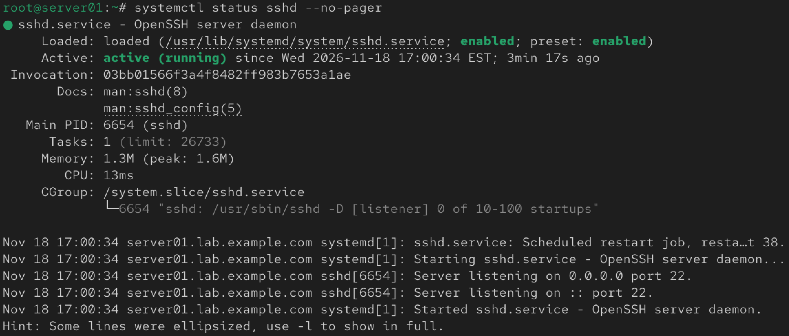
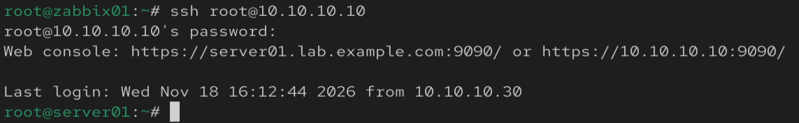
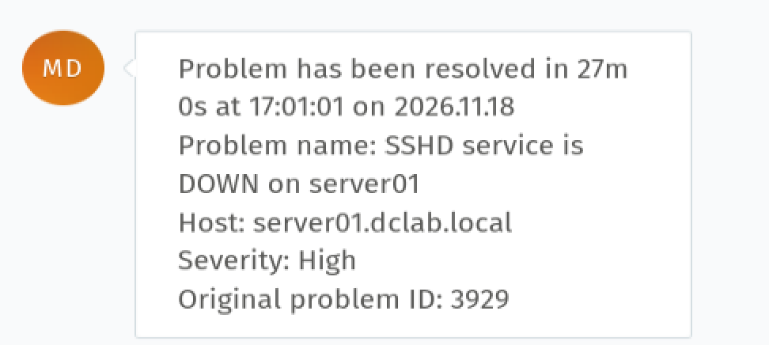

# Incident 009 — SSHD Configuration Error

## Issue

Zabbix detected that the SSH service on `server01` was unavailable.

- Host: `server01.dclab.local`
- Severity: High
- Zabbix Problem ID: 3929
- Service: OpenSSH (`sshd`)
- Port: TCP/22
- Incident duration: 27 minutes

## Detection

Zabbix generated the following alert:

`SSHD service is DOWN on server01`

The monitoring system reported an operational value of `0`, indicating that the SSH service was unavailable.



## Investigation

The SSH service status was checked:

```bash
systemctl status sshd --no-pager
```
The service was unable to start successfully and returned:
``bash
status=255/EXCEPTION
```
Systemd was attempting to automatically restart the service.



The service logs were then investigated:
journalctl -u sshd -n 30 --no-pager
```bah
The logs identified a configuration error:
/etc/ssh/sshd_config: line 133: Bad configuration option: InvalidDirective
/etc/ssh/sshd_config: terminating, 1 bad configuration options
```


The affected section of the SSH configuration was inspected:
sed -n '128,136p' /etc/ssh/sshd_config

The following invalid directive was found:
InvalidDirective Incident009



## Root Cause
An invalid directive had been added to:
/etc/ssh/sshd_config

The invalid configuration entry was:
InvalidDirective Incident009

Because OpenSSH could not recognize this directive, sshd failed during startup and returned status=255/EXCEPTION.

As a result, the SSH service became unavailable and Zabbix generated a high-severity alert.
## Resolution
The invalid directive was removed from /etc/ssh/sshd_config.

The configuration file was inspected again to confirm that the invalid entry had been removed.

The SSH configuration syntax was validated using:
```bash
sshd -t
```
No output was returned, confirming that the SSH configuration syntax was valid.

Systemd subsequently restarted the SSH service successfully.
## Verification
The SSH service returned to:
```bash
Active: active (running)
```
The service was also listening on TCP port 22.

A new remote SSH connection was tested from zabbix01:
ssh root@10.10.10.10

The connection successfully reached server01, confirming that SSH functionality had been restored.

## Monitoring Verification
Zabbix/Zammad automatically detected the recovery and marked the incident as resolved.
- Resolution time: 17:01:01
- Date: 2026-11-18
- Total incident duration: 27m 0s
- Original Problem ID: 3929

## Skills Demonstrated
- Linux service troubleshooting
- OpenSSH administration
- systemd service analysis
- Linux log analysis with journalctl
- SSH configuration troubleshooting
- Configuration syntax validation with sshd -t
- TCP/22 service verification
- Remote SSH connectivity testing
- Zabbix monitoring
- Zammad incident workflow
- Root cause analysis
- Post-resolution verification
